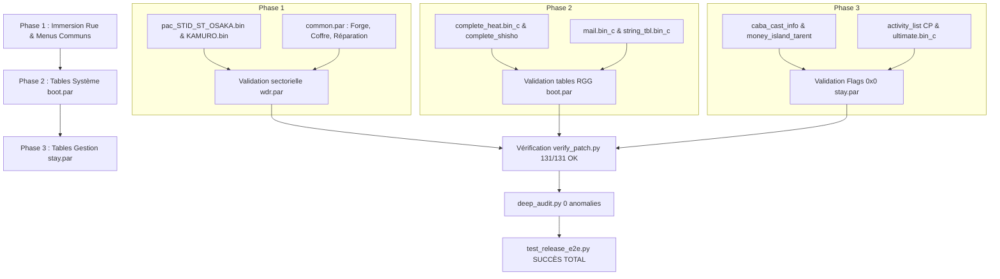

# Audit Exhaustif des Textes Non Traduits (Anglais Résiduel) & Matrice de Sécurité

> **Date de l'audit :** 23 Septembre 2026  
> **Version cible :** Patch Français Yakuza 0 GOG (v1.12.9)  
> **Périmètre :** 131 archives `.par` et 28 fichiers `.bin_c` autonomes (`release_gog/data`)  
> **Référence technique obligatoire :** [`docs/DEBUG_KNOWLEDGE_BASE.md`](file:///home/dev/repos/yakuza0-FR-Patch-GOG/docs/DEBUG_KNOWLEDGE_BASE.md) et [`AGENTS.md`](file:///home/dev/repos/yakuza0-FR-Patch-GOG/AGENTS.md)

---

## 1. Synthèse Globale de l'Audit

L'audit automatisé a passé au crible l'ensemble des fichiers de jeu du patch français pour identifier tout texte encore en langue anglaise.

```
Total des archives .par auditées              : 131
Archives 100% en français (0 texte anglais)   : 124 (94.6%)
Archives contenant encore de l'anglais        : 7
Total de fichiers contenant de l'anglais      : 168
Nombre total de chaînes anglaises résiduelles : 1 374
```

### Répartition par catégorie de jeu :

| Catégorie de Contenu | Archive(s) Concernée(s) | Nb Fichiers | Nb Chaînes Anglaises | Priorité Joueur |
|---|---|---|---|---|
| **Passants de rue & Bulles d'ambiance** | `data/wdr_par_c/wdr.par` | 94 | 273 | 🔥 **Haute** (Immersion ville) |
| **Menus Marchands, Coffre & Forge** | `data/wdr_par_c/common.par` | 8 | 51 | 🔥 **Haute** (Gameplay quotidien) |
| **Gestion, Cabaret, Immobilier & CP** | `data/staypar/stay.par` | 21 | 544 | ⚡ **Moyenne** (Minijeux majeurs) |
| **Système, Heat Actions & Bipeur** | `data/bootpar/boot.par` | 31 | 493 | ⚡ **Moyenne** (Combats & Menus) |
| **Mini-jeux spécifiques (Disco, etc.)** | `pausepar_e/pause.par`, `minigame/*` | 10 | 13 | 🟢 **Basse** (Ponctuel) |
| **Balises audio internes (Faux positifs)** | `data/soundpar/sound.par` | 4 | 22 | ⚪ **Nulle** (Non affiché en jeu) |
| **Cinématiques de l'histoire (17 chap.)** | `data/auth_w64_e/*.par` | 0 | **0** | ✅ **100% Traduit** |

---

## 2. Inventaire Exhaustif par Catégorie

### A. Passants de Rue & Randonneurs (`data/wdr_par_c/wdr.par`) — 273 chaînes

Ce sont les textes ambiants qui s'affichent au-dessus des passants (bulles de dialogue) ou lors des déplacements libres en ville. C'est ici que se trouve le bug constaté de la quête de **« l'homme statue »** sur le pont Iwao à Osaka.

#### 1. Sotenbori / Osaka (`pac_STID_ST_OSAKA.bin` — 33 chaînes) :
* **Cause du signalement de l'homme statue :** Les bulles des spectateurs et passants autour du pont Iwao et des rues d'Osaka sont stockées dans ce fichier.
* **Exemples de répliques non traduites :**
  - `Someone, anyone... Help!`
  - `Hey! You there!`
  - `Can't block bullets!`
  - `Please! Let me explain!`
  - `You're not getting away with this!`
  - `What the hell's going on!?`
  - `I'm so cold...`
  - Monologues intérieurs de Majima :
    - `(Not like I had business across the bridge anyway. Gotta hurry to Hogushi Kaikan now.)`
    - `(Gotta keep my distance.)`
    - `(Wonder what's up... I got no time for detours.)`
    - `(This's the long way around...)`
    - `(Better avoid the stairs...)`
    - `(Stairs are a bad idea...)`
  - Quête danse de rue : `(The target's \2,000,000, and we're showin' off...)`

#### 2. Kamurocho (`pac_STID_ST_KAMURO.bin` — 71 chaînes) :
* Distributeurs de mouchoirs dans la rue :
  - `How about some pocket tissues?`
  - `Get your tissues here!`
* Réactions des passants et racailles :
  - `Oh, Mina-chan... What should I do?` / `Be honest with me!`
  - `Wanna go start a fight?`
  - `I'm bored outta my skull!`
  - `Let's go kick some ass.`
  - `This domain is ours! Defy us, and it's game over!`
* Monologues de Kiryu lors des filatures / fuites :
  - `(Main roads are too risky. Better stick to back alleys.)`
  - `(Can't go back the way I came. My best bet's going to Pink Street.)`
  - `(This way's dangerous. Gotta get away from here.)`

#### 3. Aboyeurs et Événements de Quartier (Stage PACs — ~30 chaînes) :
* Tripot du Parc Ouest (`pac_STID_ST_K_WESTPARK.bin`) : *« Cho-han's the game to play! »*, *« Come play oicho-kabu! »*, *« Cee-lo is really fun! »*.
* Casino d'Osaka (`pac_STID_ST_O_CASINO.bin`) : *« Would you like to play poker? »*, *« How about roulette? »*, *« Play high rate blackjack here! »*.
* Discothèque Maharaja (`pac_STID_ST_K_MAHARAJA.bin` & `pac_STID_ST_O_MAHARAJA.bin`) : *« I'm the greatest dancer! »*, *« Miss Isobe! I love you! »*.
* Événements Tojo / Grand (`pac_STID_ST_TOJO.bin`, `pac_STID_ST_O_GRAND.bin`) : *« (It's shut tight. That door's not budging.) »*, *« Gotta get that 500 grand somehow... »*.

#### 4. Boutiques secondaires & Commerces du Cabaret :
* Vendeur spécial Ebisu (`ex_shop0000.bin`) : *« Is this what you want? »*, *« (I don't have any space.) »*, *« (I don't need this.) »*.
* Commandes de restaurants (`shop0033.bin`, `shop0034.bin`) : *« Would you like to order this? »*.
* Commerces partenaires de Cabaret Club (`uid010c1799.msg`, `uid010c1948.msg` à `uid010c1959.msg`) : *« (Rakuen-en, eh? That's a Club Mars area business.) »*, *« (Death Curry, eh? That's a Club Venus area business.) »*.

---

### B. Menus Marchands, Coffre & Forge (`data/wdr_par_c/common.par`) — 51 chaînes

Ces menus sont appelés très fréquemment par le joueur lorsqu'il interagit avec les marchands de service :
* **Forge Dragon & Tigre (`blacksmith.bin` — 8 chaînes) :**
  - `That'll be %s. Is that all right?` *(Ça fera %s. Cela vous convient ?)*
  - `It'll cost %s to make. Is that okay?` *(La fabrication coûtera %s. D'accord ?)*
* **Réparation d'armes (`arms_repair.bin` — 6 chaînes) :**
  - `(I don't have anything that needs repair.)` *(Je n'ai rien qui nécessite une réparation.)*
  - `That'll come to %s.` *(Ça fera %s.)*
* **Vente au Mont d'Ébisu (`sale0000.bin`, `sale0001.bin`, `sale0002.bin` — 20 chaînes) :**
  - `(I don't have anything to sell.)` *(Je n'ai rien à vendre.)*
  - `(Got nothing on me to sell.)` *(Rien à vendre sur moi.)*
* **Coffre à objets & Défausse (`send.bin`, `throw.bin`, `present.bin` — 17 chaînes) :**
  - `(I don't have any space. Guess I'll send it to the Item Box.)` *(Plus de place. Je l'envoie au Coffre.)*
  - `Are you sure you want to discard this?` *(Voulez-vous vraiment jeter cet objet ?)*
  - `(It'd be a waste to just throw this away.)` *(Ce serait du gâchis de jeter ça.)*
  - `(I don't have anything to hand over.)` *(Je n'ai rien à donner.)*

---

### C. Gestion, Cabaret Club, Immobilier & CP (`data/staypar/stay.par`) — 544 chaînes

Toutes les données résidentes de gestion d'activités :

1. **Objectifs de Points de Complétion / CP (`activity_list.bin_c` — 216 chaînes) :**
   - *« Talk to people %d times »*
   - *« Buy from Dream Machines %d times »*
   - *« Defeat %d enemies on the street »*
   - *« Help %d attack victims around town »*
   - *« Complete Gindaco »*, *« Complete Yoronotaki »*
2. **Recherche d'armes Dragon & Tigre (`search_arms_location.bin_c` & `search_arms_agent.bin_c` — 121 chaînes) :**
   - Zones d'exploration : *« The Arctic »*, *« Dispatch agents to locations in Japan... »*, *« Areas known for oil, extreme wealth... »*
   - Rapports de mission (`search_arms_result_picture.bin_c`) : *« Sudden setback! Interference from the locals. »*, *« Tight spot! Surrounded by men who look like bad news. »*
3. **Biographies des Hôtesses du Sunshine (`caba_cast_info.bin_c` — 29 chaînes) :**
   - Profils de recrutement : *« The star of this club. She's a diamond in the rough who could shine. »*
   - *« One of Sotenbori's top girls, her customer care skills are unparalleled. »*
4. **Biographies des Employés Immobiliers (`money_island_tarent.bin_c` — 29 chaînes) :**
   - Profils des managers et agents de sécurité de Kiryu : *« I'm all about keeping things the same... »*, *« I know Kamurocho's underbelly inside out... »*
5. **Descriptions des Clubs Rivaux (`cabaret_island_area.bin_c` — 15 chaînes) :**
   - Club Mars, Club Jupiter, Club Mercury, Club Vénus, Club Moon.
6. **Combats Ultimes (`ultimate.bin_c` — 14 chaînes) :**
   - *« Missions with special completion requirements. »*
   - *« Defeat all enemies in a variety of situations. »*
   - *« Fulfill monetary requirements to win big. »*
7. **Rangs de fin de combat & Manette (`battle_result.bin_c`, `controller_explain.bin_c` — 72 chaînes) :**
   - *« The Brawler »*, *« The Rusher »*, *« The Beast »*, *« Enemy Down »*.
   - *« Finish/Back »*, *« Cancel Close Window »*.

> 📌 **Note :** La quasi-totalité des traductions françaises de ces tables a déjà été préparée dans [`tools/stay_translations_data.py`](file:///home/dev/repos/yakuza0-FR-Patch-GOG/tools/stay_translations_data.py).

---

### D. Système, Actions Heat & Bipeur (`data/bootpar/boot.par`) — 493 chaînes

1. **Actions Heat / Coups Spéciaux (`complete_heat.bin_c` — 138 chaînes) :**
   - Noms et descriptions des Heat Actions : *« Head Crush: Back »*, *« Essence of the Stove »*, *« Essence of the Stun Gun »*, *« Essence of the Beast »*, etc.
2. **Prompts Système & Boutons d'Interface (`string_tbl.bin_c` — 195 chaînes) :**
   - *« Back »*, *« Close »*, *« OK Back »*, *« Next »*.
3. **Compétences d'Entraînement des Maîtres (`complete_shisho.bin_c` — 39 chaînes) :**
   - *« Floating Re-Guard »*, *« Essence of the Beast: Wall Pin »*, *« You learned the Essence of Face Twisting. »*
4. **Messages du Bipeur / Pager (`mail.bin_c` — 24 chaînes) :**
   - *« It's from Nishiki... »*
   - *« "724106" is code for, "Whatcha up to?" »*
5. **Titres d'Adversaires & Menus Resto (`battle_deck_list.bin_c`, `restaurant_menu.bin_c` — 21 chaînes) :**
   - Titres des opposants : *« Street Emperor »*, *« Just a Dancer »*.
   - Monologue de Kiryu au restaurant : *« (Hmm, I'm not really feelin' it...) »*.

> 📌 **Note :** Ces tables sont déjà traduites en français dans [`par_original/boot_steam_fr.par`](file:///home/dev/repos/yakuza0-FR-Patch-GOG/par_original/boot_steam_fr.par).

---

## 3. Matrice des Risques & Règles de Sécurité Inviolables

Pour chaque catégorie de fichier à modifier, voici les **règles strictes issues du reverse-engineering** à respecter impérativement pour éviter de réintroduire les bugs historiques documentés dans la base de connaissances.

### 🛡️ Règle de Sécurité N°1 : Alignement Sectoriel 2 048 octets (`pause.par`, `stay.par`, `boot.par`, `wdr.par`)
* **Bug historique évité :** Crash `0x234B0` à la pharmacie et crash `0xA4526` au chargement de sauvegarde.
* **Mécanisme :** Le moteur Sega lit les textures 2D et les flux audio/stage par secteurs physiques de 2 048 octets (`(curr_off + 2047) & ~2047`).
* **Consigne absolue :**
  - Lors de la modification de `wdr.par`, `stay.par` ou `boot.par`, utiliser **exclusivement le modèle Append-Only**.
  - Ne **JAMAIS** recompiler l'archive séquentiellement, ce qui décalerait les offsets originaux Sega (ex: `response_wanderer.bin_c` doit rester rigoureusement à son offset d'origine `0x9A000`).
  - Chaque fichier injecté à la fin de l'archive doit démarrer sur un multiple exact de 2 048 octets (`0x800`).

---

### 🛡️ Règle de Sécurité N°2 : Préservation des Structures RGG (`0x20070319`) & Pas de Chaînes Nulles
* **Bugs historiques évités :**
  - Crash `0x371324` (`ACCESS_VIOLATION` sur pointeur de colonne décalé).
  - Crash `0x9C4861` (Faussaire Substory 49 / ItemGet HUD lors de l'accès à une chaîne de nom vide).
* **Mécanisme :** Les tables `.bin_c` stockent des en-têtes définissant des tailles fixes par colonne. Remplacer du texte sans compenser par du null-padding in-place déphase les pointeurs de colonnes. De plus, aucune ligne active de colonne `NAME` ne doit être vide.
* **Consigne absolue :**
  - Si traduction in-place : `encoded = text.encode('latin1')`, compléter rigoureusement la différence avec des espaces ou zéros : `encoded + b'\x00' * (orig_len - len(encoded))`.
  - Si recompilation complète depuis `boot_steam_fr.par` : vérifier que la table de colonnes est bit-exacte avec la structure GOG et qu'aucune chaîne de `NAME` n'est tronquée à zéro octet.

---

### 🛡️ Règle de Sécurité N°3 : Respect Strict des Flags SLLZ (`0x80000000` vs `0x0`)
* **Bug historique évité :** Crash instantané au Boot à `0x1400EB0CF`.
* **Mécanisme :** Dans `stay.par`, les tables vanilla ayant `flags = 0x0` (`response_roulette.bin_c`, `controller_explain.bin_c`, `battle_result.bin_c`, `cabaret_island_area.bin_c`) sont lues telles quelles en mémoire brute sans décompression SLLZ. Les compresser en SLLZ injecte l'en-tête `SLLZ` dans le parser de données, provoquant le crash immédiat au démarrage.
* **Consigne absolue :**
  - Conserver rigoureusement `flags = 0x0` et les données **non-compressées** pour ces tables brutes de `stay.par`.
  - Pour les fichiers qui requièrent la compression SLLZ (ex: `ai_popup.bin`, `item.bin_c`), toujours utiliser [`tools/sllz.py`](file:///home/dev/repos/yakuza0-FR-Patch-GOG/tools/sllz.py) avec `flags = 0x80000000`.

---

### 🛡️ Règle de Sécurité N°4 : Intégrité des Scripts `.msg` (Dialogue & Bytecode)
* **Bugs historiques évités :**
  - Softlock permanent de Bob Utsunomiya 0 (`uid00331696.msg`, `uid003316a2.msg`) sur la réplique *« Mais c'est offert pour toi, tu sais ? »*.
  - Softlock des cabines de sauvegarde (`uid033317d1.msg` à `uid033317e4.msg`).
* **Mécanisme :** Les scripts `.msg` contiennent des offsets de sauts compilés dans le bytecode. Le moteur calcule la longueur de dialogue via une boucle de machine à écrire (`0x140396783`). L'octet nul `\x00` agit comme un terminateur prématuré de script.
* **Consigne absolue :**
  - Utiliser **exclusivement du space-padding (`b' '`)** pour ajuster la longueur des répliques de dialogue, et réserver le null-padding (`b'\x00'`) strictement aux mots d'interface courts.
  - La taille décompressée des fichiers de Bob doit faire **exactement 27 575 octets**.
  - Les cabines téléphoniques doivent conserver la formule pure ASCII calibrée à **pile 58 caractères**.

---

### 🛡️ Règle de Sécurité N°5 : Encodage Windows-1252 Strict (Anti-Mojibake & Pas de `™`)
* **Bug évité :** Remplacement des apostrophes courbes `’` par `™` (`\x99`), décalage de lettres sur `i` et `l`, ligatures `œ` invisibles.
* **Consigne absolue :**
  - Aucun octet UTF-8 multi-octets (`\xc3\xa9`, `\xe2\x80\x99`, etc.).
  - Apostrophes droites standards `'` (`0x27`).
  - Remplacer les ligatures `œ` / `Œ` par `oe` / `OE`.
  - Encodage en `latin1` / Windows-1252 pur.

---

### 🛡️ Règle de Sécurité N°6 : Taille et Intégrité de `wdr.par`
* **Bug historique évité :** Boucle infinie de bswap de 529 Mo et crash `0x6EA328` (`mov %ecx, -0x8(%r9)`).
* **Consigne absolue :**
  - `release_gog/data/wdr_par_c/wdr.par` DOIT impérativement contenir **au moins 241 fichiers** et peser **plus de 7 Mo** (~7,3 Mo minimum). Ne jamais omettre un sous-fichier non traduit.

---

## 4. Protocole Opérationnel Recommandé par Phase

Pour traduire ces éléments sans perturber la stabilité du patch v1.12.9 :



### Étape 1 : Passants de rue & Menus marchands (Phase 1)
1. Traduire les chaînes de `pac_STID_ST_OSAKA.bin` et `pac_STID_ST_KAMURO.bin` avec space-padding in-place.
2. Traduire les 51 chaînes de `common.par` (`blacksmith.bin`, `arms_repair.bin`, `sale*.bin`, `send.bin`, `throw.bin`).
3. Reconstruire `wdr.par` et `common.par` en Append-Only 2 048 octets.
4. Exécuter `python3 tools/verify_patch.py release_gog`.

### Étape 2 : Tables Système `boot.par` (Phase 2)
1. Nettoyer les encodages (éliminer mojibake et `™`) des tables `complete_heat.bin_c`, `complete_shisho.bin_c`, `mail.bin_c` issues de `boot_steam_fr.par`.
2. Vérifier que la structure des colonnes RGG correspond à 100% à celle du binaire GOG.
3. Les injecter via [`tools/rebuild_clean_boot_append.py`](file:///home/dev/repos/yakuza0-FR-Patch-GOG/tools/rebuild_clean_boot_append.py).
4. Valider l'absence de colonnes vides dans les noms.

### Étape 3 : Tables de Gestion `stay.par` (Phase 3)
1. Vérifier que les tables brutes (`controller_explain.bin_c`, `battle_result.bin_c`, `cabaret_island_area.bin_c`) conservent strictement `flags = 0x0` et **aucune compression SLLZ**.
2. Injecter les biographies d'hôtesses (`caba_cast_info.bin_c`) et de gérants (`money_island_tarent.bin_c`).
3. Reconstruire avec [`tools/rebuild_clean_stay_append.py`](file:///home/dev/repos/yakuza0-FR-Patch-GOG/tools/rebuild_clean_stay_append.py).

### Étape 4 : Validation Finale Obligatoire
* `python3 tools/verify_patch.py release_gog` $\rightarrow$ **131/131 OK**.
* `python3 tools/deep_audit.py release_gog/data` $\rightarrow$ **SUCCÈS TOTAL (0 anomalie)**.
* `python3 tools/test_release_e2e.py` $\rightarrow$ **SUCCÈS TOTAL**.
* **Aucune release publique sans accord explicite de l'utilisateur.**
