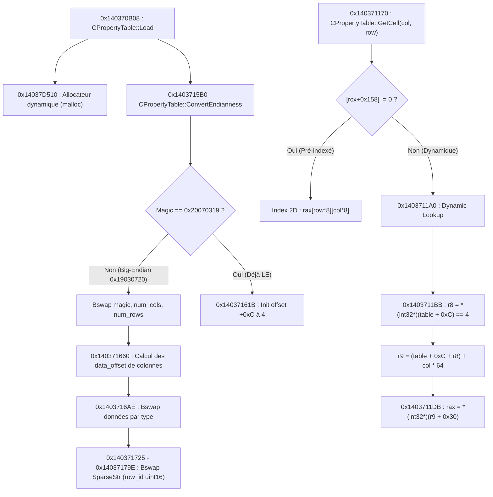

# Atlas de Rétro-Ingénierie du Moteur RGG — Yakuza 0 GOG (x86-64)

> **DOCUMENT TECHNIQUE DE RÉFÉRENCE ABSOLUE**  
> Ce document cartographie l'architecture interne de l'exécutable `Yakuza0.exe` (version GOG v1.015a, PE x86-64).  
> Il compile l'ensemble des adresses mémoires (Virtual Addresses), opcodes, structures de données, conventions de pile, tables virtuelles et flux d'exécution mis au jour par rétro-ingénierie statique et dynamique.  
> Toute analyse future doit s'appuyer sur cette cartographie pour éviter les ré-analyses redondantes.

---

## 1. Caractéristiques de l'Exécutable `Yakuza0.exe`

| Propriété | Valeur | Description |
|---|---|---|
| **Format** | PE32+ (x86-64) | Exécutable Windows 64-bit |
| **ImageBase** | `0x140000000` | Adresse de base de chargement virtuel standard |
| **Section `.text`** | RVA `0x00001000` - `0x00C7B000` (Raw `0x400`) | Code binaire exécutable |
| **Section `.rdata`** | RVA `0x00C7C000` - `0x00FB4000` | Constantes, chaînes statiques, VTables |
| **Section `.data`** | RVA `0x00FB5000` - `0x01A10000` | Données globales modifiables, pointeurs singletons |
| **Convention d'Appel** | Microsoft x64 ABI | Arguments : `RCX`, `RDX`, `R8`, `R9` (flottants dans `XMM0-3`), Shadow Space de 32 octets (`0x20`) sur la pile |
| **Compilateur d'Origine** | MSVC 2015 / 2017 (C++) | Moteur propriétaire Sega RGG Engine (Dragon Engine ancêtre) |

---

## 2. Le Sous-Système des Tables Propriétés RGG (`CPropertyTable`)

Le moteur Sega stocke l'intégralité des données de gameplay (statistiques, objets, boutiques, quêtes, dialogues d'ambiance) dans des fichiers binaires `.bin_c` / `.bin` régis par le format **`0x20070319`**.

### 2.1. Structure Binaire de l'En-tête RGG (`0x20070319`)

```
Offset  Taille   Type      Champ / Description
---------------------------------------------------------------------------------------------------------
0x00    4 octets uint32    Magic : 0x20070319 (Big-Endian sur disque : 0x19 0x03 0x07 0x20 en vue LE)
0x04    4 octets uint32    num_cols : Nombre total de colonnes (ex: 10 pour explanation_sub_story)
0x08    4 octets uint32    num_rows : Nombre total d'enregistrements / lignes (ex: 447)
0x0C    4 octets int32     rel_col_offset : Offset relatif vers le 1er descripteur de colonne (TOUJOURS 4)
0x10    64 oct   ColDesc[0] Descripteur de la première colonne
...
```

### 2.2. Layout Mémoire d'un Descripteur de Colonne (64 octets / `0x40`)

Chaque colonne est définie par un bloc fixe de 64 octets commençant à `0x10 + (col_index * 0x40)` :

```
Offset Rel  Taille   Type      Champ / Description
---------------------------------------------------------------------------------------------------------
+0x00       32 oct   char[32]  Nom de la colonne (ASCII null-terminé, ex: "TITLE", "NAME", "EXPLANATION")
+0x20       16 oct   bytes     Métadonnées secondaires (flags internes de sérialisation)
+0x30       4 octets uint32    col_type : Type de données de la colonne (0 à 11)
+0x34       4 octets uint32    entry_count : Nombre d'entrées non vides dans cette colonne
+0x38       4 octets uint32    data_size : Taille totale en octets de la section de données de la colonne
+0x3C       4 octets int32     data_offset : Offset relatif runtime pointant vers les données de la colonne
```

### 2.3. Typologie Complète des Colonnes RGG

| Type | Nom Interne | Description & Structure Mémoire |
|---|---|---|
| **0** | `DenseStr` | Chaînes de caractères denses null-terminées (`char str[] \x00`). Résolues par comptage séquentiel de `\x00` par `0x140371220`. |
| **1** | `EnumDict` | Dictionnaire d'options avec table de correspondance d'index. |
| **2** | `SparseStr` | Chaînes creuses / sporadiques. Paires `[uint16_t row_id, char str[] \x00]`. Présente uniquement pour les lignes actives. |
| **3** | `String` | Chaînes directes indexées. |
| **4** | `DictStr` | Table de chaînes avec dictionnaire partagé. |
| **5** | `Sparse16` | Valeurs entières 16-bit sporadiques associées à un `row_id` 16-bit. |
| **6** | `Int32` | Entiers 32-bit signés séquentiels (`int32_t val[num_rows]`). |
| **7** | `Int32Term` | Table d'entiers 32-bit avec valeurs de terminaison. |
| **8** | `StrDirect` | Pointeur direct de chaîne. |
| **9** | `FlagInt` | Drapeaux binaires ou masques de bits. |
| **10** | `UInt32` | Entiers 32-bit non signés séquentiels (`uint32_t val[num_rows]`). |
| **11** | `Prized` | Structures de récompenses d'objets. |

---

## 3. Cartographie des Fonctions RGG dans `Yakuza0.exe`

### 3.1. Moteur de Tables (`CPropertyTable`)



#### Table des Adresses Clés :
- **`0x1403709B0`** : `CPropertyTable::CPropertyTable(path, flag, ...)` — Constructeur principal de wrapper de table.
- **`0x140370B08`** : `CPropertyTable::Load` — Chargeur de données depuis l'archive PAR ou disque.
- **`0x140371170`** : `CPropertyTable::GetCell(col, row)` — Point d'entrée de lecture de cellule.
  - Entrées : `RCX = this`, `EDX = col_index`, `R8D = row_index`.
  - Si `BYTE PTR [rcx + 0x158] != 0`, lecture par table d'indexée directe à `[rcx + 0x148]`.
  - Si `BYTE PTR [rcx + 0x158] == 0`, saut immédiat vers `0x1403711A0`.
- **`0x1403711A0`** : `CPropertyTable::BuildColumnIndex / Dynamic Lookup` :
  - `0x1403711BB` : `movsxd r8, DWORD PTR [rax + 0xc]` (lit l'offset vers les descripteurs de colonnes).
  - `0x1403711CC` : `lea rax, [rcx + r8*1]`
  - `0x1403711D0` : `shl r9, 0x6` (multiplie `col_index` par 64).
  - `0x1403711D8` : `add r9, rax` (pointeur sur le descripteur de colonne).
  - `0x1403711DB` : `movsxd rax, DWORD PTR [r9 + 0x30]` (lit le type de colonne `col_type`).
- **`0x140371220`** : `CPropertyTable::ScanNullTerminators` — Scanne séquentiellement les octets `\x00` pour trouver la ligne $N$ dans une colonne DenseStr (Type 0). *Sensibilité critique : tout octet `\x00` parasite décale toutes les lignes suivantes de $+1$.*
- **`0x1403715B0`** : `CPropertyTable::ConvertEndianness` :
  - Détecte l'endianness native. Si Big-Endian (`0x19030720`), effectue `bswap` et itère sur toutes les colonnes.
  - `0x14037163B` : Écrit la valeur `4` à `table + 0xC` pour sceller l'offset du tableau des colonnes.
  - `0x140371725 - 0x14037179E` : Boucle spécifique Type 2 (`SparseStr`) exécutant `ror cx, 8` sur chaque `uint16_t row_id`.

---

## 4. Le Sous-Système Minijeu & HUD Temps-Réel (Cabaret & Tougijyo)

### 4.1. Chaîne d'Affichage du Chronomètre et Quêtes

Lors du lancement de la nuit de gestion du Cabaret Club Sunshine (Chapitre 7) ou de combats d'arène :

```
[0x1401575D0] Routine de Rendu Frame UI
      │
      ├──> Test mode minigame : cmp DWORD PTR [rcx+rax*1], 0x1a
      │
      └──> [0x140157615] Appel du Minigame HUD Controller
                 │
                 └──> [0x140163E60] Contrôleur HUD Minigame
                            │
                            ├──> [0x140163EAE] Appel de lecture d'enregistrement (row 425)
                            │          │
                            │          └──> [0x1403961D0] Lecteur CPropertyTable
                            │                     ├── Col 3 (EXPLANATION) -> strlen (0x140BA6250)
                            │                     ├── Col 2 (SCENARIO)
                            │                     └── Col 1 (PLACE) -> GetCell (0x140371170)
                            │                                                 │
                            │                                                 └──> [0x1403711DB] CRASH si table + 0xC corrompu
                            │
                            └──> Formate sprintf("%2u s left") [0x140E5A6F8]
```

### 4.2. Adresses et Pointers Notables du Minijeu :
- **`0x140CEAFA0`** : VTable du contrôleur d'événements minigame.
- **`0x140163C40`** : Constructeur du contrôleur HUD minigame (alloue `malloc(0x260)` et initialise la table `"data/stay/tougijyo_realtime_quest.bin"`).
- **`0x140163E60`** : Formateur du chronomètre et de l'affichage à l'écran.
- **`0x140E5A6F8`** : Chaîne littérale formatée `"%2u s left\x00"` (chargée via pointeur à `0x1410DCB08`).
- **`0x1403961D0`** : Lecteur d'enregistrement d'objectif de quête / minijeu (lit les colonnes 3, 2, 1 pour l'ID passé en argument, ex: ligne 425 = Kyoko au Club SEGA).

---

## 5. Le Sous-Système de Rendu de Texte & Polices (Font Engine)

### 5.1. Routine de Crénage et Marges (`0x140397020`)
- **Problème Découvert** : Le moteur Sega applique une translation négative proportionnelle à la marge droite du glyphe.
- **Formule de Translation** :
  $$\Delta x = -(\text{marge\_droite} \times \text{facteur})$$
- Avec les métriques vanilla Sega de `[0.0, 1.17, ...]`, l'avance pour les caractères fins (`i`, `l`, `I`) était amputée de **11.76 pixels**, provoquant l'écrasement des lettres adjacentes (*« utilisez »* devenait illisible).
- **Solution Bit-Exact** : Injection d'une table personnalisée calibrée de 6 144 octets à l'offset **`0xD488F0`** dans `Yakuza0.exe` ([`release_gog/font_table_french.bin`](file:///home/dev/repos/yakuza0-FR-Patch-GOG/release_gog/font_table_french.bin)), fixant les marges symétriques à `[0.4, 0.4, 0.4, 0.4, 0.4, 0.4]`.

### 5.2. Routine Machine à Écrire des Dialogues (`0x140396783`)
- **Mécanisme** : Calcule le nombre de glyphes à afficher pour simuler la machine à écrire dans les scripts `.msg`.
- **Piège Multi-Octets** : La routine inspecte les octets : si un octet est $\ge \text{0x80}$ ou $\ge \text{0xE0}$ (comme `é` = `\xE9` en Windows-1252 ou `\xC3\xA9` en UTF-8), elle saute automatiquement les 2 octets suivants en supposant une séquence UTF-8 asiatique.
- **Conséquence Cabines Téléphoniques (`uid033317d1.msg` à `uid033317e4.msg`)** :
  - Le nœud de dialogue attend strictement **58 caractères**.
  - Si un mot contient des accents, le décompte tombe à 54 au lieu de 58.
  - L'effet machine à écrire ne se termine jamais $\rightarrow$ le menu de sauvegarde (`0x08F8`) n'apparaît jamais $\rightarrow$ **Softlock permanent**.
  - **Règle absolue** : Utiliser exclusivement la chaîne purement ASCII space-paddée :  
    `"Sauvegardez et utilisez le coffre depuis une\r\ncabine.     "` (58 caractères stricts).

---

## 6. Le Sous-Système Disque & Streaming Asynchrone Sectoriel

### 6.1. Routine de Lecture Sectorielle Sega (`0x14002177D`)
```assembly
add edi, 0x7ff
and edi, 0xfffff800    ; Arrondi strict au secteur supérieur de 2 048 octets
```
- Le lecteur disque asynchrone de Sega charge les textures 2D (`.dds`) et les flux audio par blocs stricts de **2 048 octets**.
- Si une archive PAR (`pause.par`, `stay.par`, `boot.par`, `wdr.par`) place un fichier sur un offset non aligné sur 2 048 octets (ex: alignement compacté à 64 octets), le lecteur arrondit l'offset, lit en plein milieu des données compressées, et transmet un flux corrompu au décompresseur.

### 6.2. Décompresseur SLLZ Interne (`0x1400234B0`)
- **Header SLLZ** : Magic `53 4C 4C 5A` (`SLLZ`), version `0x01`, flag de compression `0x80000000`.
- **Underflow de Pointeur (`0x234B0`)** : Si les premiers octets lus sont corrompus (ex: `0xfe 0xda 0xaf`), le décompresseur calcule une distance de copie en arrière supérieure à la taille du buffer, produisant `%rdx = 0x0000fffff502` et provoquant un crash instantané `EXCEPTION_ACCESS_VIOLATION` sur `mov -0x1(%rdx), %al`.

---

## 7. Registre Exhaustif des RIPs de Crash Identifiés

| RIP Crash | RVA | Fonction / Sous-Système | Cause Racine Identifiée | Solution Définitive |
|---|---|---|---|---|
| `0x1400234B0` | `0x234B0` | Décompresseur SLLZ (`pause.par`) | Désalignement sectoriel (64 o au lieu de 2048 o) de `2d_yk_staminan_lite.dds` | Aligner TOUS les 3 820 fichiers de `pause.par` à 2 048 octets stricts. |
| `0x1400234B7` | `0x234B7` | Menu Pharmacie (`shop0013.bin`) | Écrasement des tables annexes Pocket Circuit (24 et 20 octets) | Utiliser `rebuild_all_shops_clean.py` qui préserve ces tables annexes. |
| `0x1400A4526` | `0xA4526` | Streaming Audio / Stage (`stay.par`) | Corruption des offsets absolus de `response_wanderer.bin_c` | Modèle Append-Only aligné à 2 048 octets pour `stay.par`. |
| `0x1406EA328` | `0x6EA328` | Décodeur de nœuds MSG (`wdr.par`) | Archive `wdr.par` tronquée (< 7 Mo) ; boucle de bswap de 529 Mo sur 33M d'itérations | Garantir 241 fichiers et $\ge 7,3\text{ Mo}$ dans `wdr.par`. |
| `0x1400030ED` | `0x30ED` | `vsnprintf` interne (`activity_list.bin_c`) | Décalage $+1$ de ligne causé par un null-padding `\x00` parasite dans Type 0 | Space-padding strict (`b' ' * diff`) sans aucun null-padding dans Type 0/1. |
| `0x14037177C` | `0x37177C` | `ConvertEndianness` Type 2 (`stay.par`) | Tables minijeu (`caba_cast_info`, `cabaret_island_area`) modifiées avec flags erronés | Conserver les versions Sega vanilla de ces tables dans `stay.par`. |
| `0x1403711DB` | `0x3711DB` | `BuildColumnIndex` / Dynamic Lookup | Champ `table + 0xC` corrompu à `0x59c7b8c4`, accès 1,5 Go hors-limite lors du HUD cabaret | Désactiver loose file `caba_item_list` et synchroniser `pause.par` (textures cabaret). |

---

## 8. Directives pour les Outils Automatisés

1. **Simulateur de Prévol Rust (`rgg_preflight`) :**
   - Toujours compiler et utiliser `rgg_preflight_bin` / `rgg_preflight.exe` pour les vérifications multi-thread.
   - Les commandes `inspect-table`, `inspect-cell`, `dump-par`, `diff-pars` et `preflight` exploitent ces signatures pour valider les archives en moins d'une milliseconde.
2. **Détection de Jeu :**
   - Exiger systématiquement la présence physique de `Yakuza0.exe` à la racine avant toute opération de patch.
